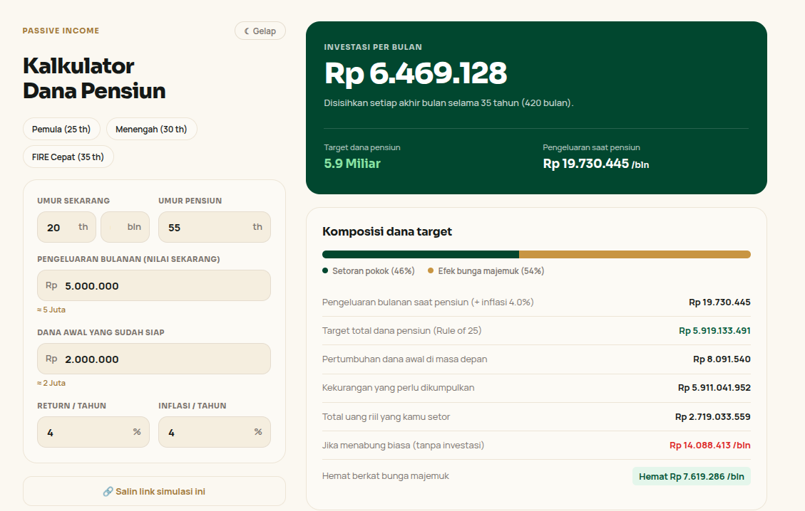

# Kalkulator Dana Pensiun



Kalkulator dana pensiun, inflasi, dan bunga majemuk. Menghitung setoran bulanan yang dibutuhkan untuk mencapai target dana pensiun.

**Akses web:** https://holycious.github.io/Pensiun-Calc/

## Fitur

- Input umur sampai presisi **bulan** (mis. 30 tahun 7 bulan).
- Format rupiah otomatis + ringkasan nominal (`≈ 10 Juta`).
- Proyeksi saldo per tahun; tahun pertama dihitung parsial sesuai sisa bulan berjalan.
- Perbandingan setoran investasi vs menabung biasa (tanpa bunga).
- Komposisi target: porsi setoran pokok vs hasil bunga majemuk.
- Dark/light mode, preset skenario, dan link simulasi yang bisa dibagikan (tersimpan di URL hash).
- 100% client-side: tanpa server, tanpa database, tanpa tracking.

## Rumus

```
m          = (umur_pensiun - umur) * 12 - bulan_berjalan
i          = return_tahunan / 12
futNeed    = pengeluaran_bulanan * (1 + inflasi) ^ (m / 12)
target     = futNeed * 12 * 25            # Aturan 4%
danaAwalFV = dana_awal * (1 + i) ^ m
setoran    = kekurangan * i / ((1 + i) ^ m - 1)
```

Asumsi: setoran di akhir bulan, return dan inflasi tetap, dana ditarik 4% per tahun saat pensiun.

## Struktur

```
index.html                     # seluruh aplikasi (HTML + CSS + JS, tanpa dependensi)
Kalkulator Dana Pensiun.html   # redirect ke index.html
```

## Menjalankan lokal

Buka `index.html` langsung di browser, atau:

```bash
python3 -m http.server 8000
# lalu buka http://localhost:8000
```

## Deploy

Hosting statis apa pun bisa dipakai. Repo ini memakai GitHub Pages:

1. Settings → Pages → Source: **Deploy from a branch**
2. Branch: `main`, folder `/ (root)`
3. Simpan; situs aktif di `https://<username>.github.io/<repo>/`
